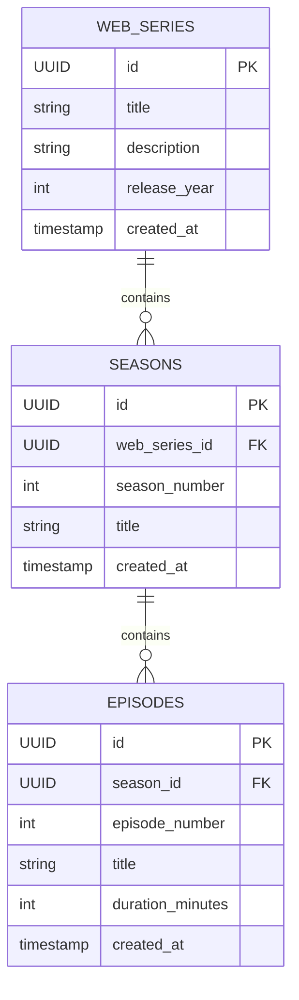

# kafkaTask
Pranav and rohit working on this repository

## Build and run

`Producer` and `Consumer` are separate Spring Boot modules. Build or run each from
its own directory; converting `Consumer` to Maven does not combine the modules.

On Windows, run the Consumer tests and application with:

```powershell
cd Consumer
.\mvnw.cmd clean test
.\mvnw.cmd spring-boot:run
```

Use `.\mvnw.cmd package` to create the Consumer JAR under `Consumer\target`.
The existing Producer module can still be built independently with
`cd Producer` followed by `.\mvnw.cmd clean test`.

## Run PostgreSQL for the Producer

The Producer's `docker-compose.yaml` starts PostgreSQL 16 on host port `5433`
(container port `5432`), avoiding a conflict with a locally installed
PostgreSQL server. The database is `webseries_db`, with the default `postgres`
username/password expected by the application. Start it from the `Producer`
directory:

```powershell
cd Producer
docker compose up -d postgres
```

Once the container is healthy, start the Producer with
`.\mvnw.cmd spring-boot:run`. Stop PostgreSQL with `docker compose down`; its
data remains in the `postgres_data` volume.

The Producer API documentation is available at
`http://localhost:8081/swagger-ui.html`; the OpenAPI JSON is at
`http://localhost:8081/v3/api-docs`. Swagger lists the web series, season, and
episode endpoints, request validation, response codes, and Kafka publish
results.

## Producer database ER diagram



The Producer database enforces `UNIQUE(web_series_id, season_number)` on
`seasons` and `UNIQUE(season_id, episode_number)` on `episodes`. Add indexes
on `seasons.web_series_id` and `episodes.season_id` for the foreign keys.
